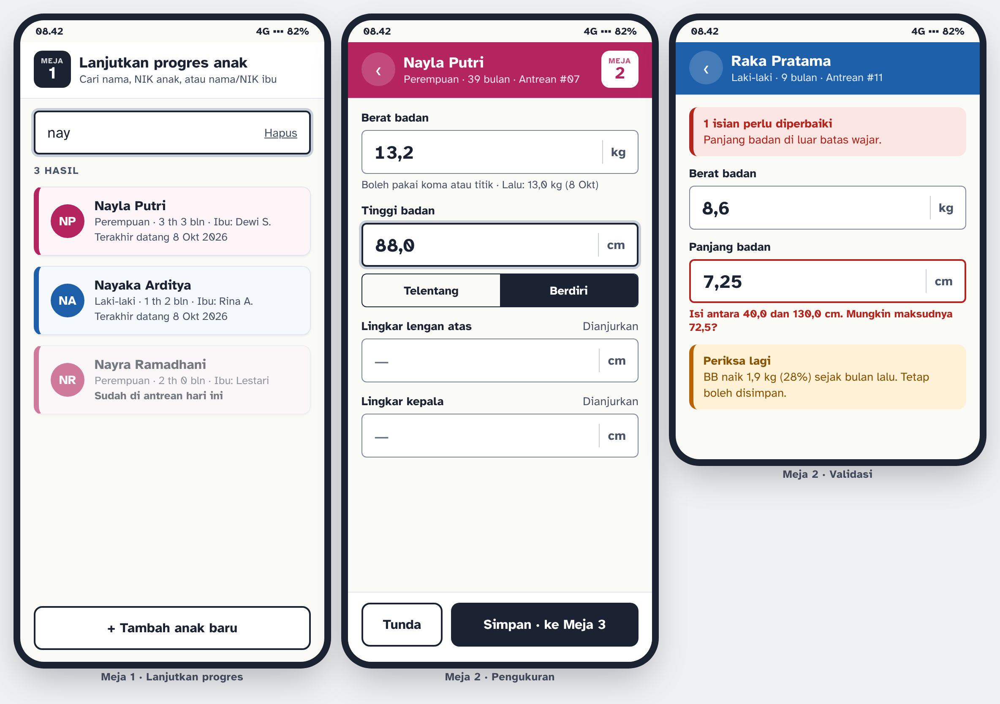
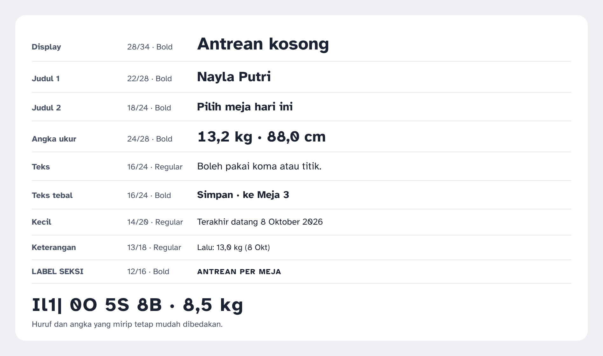
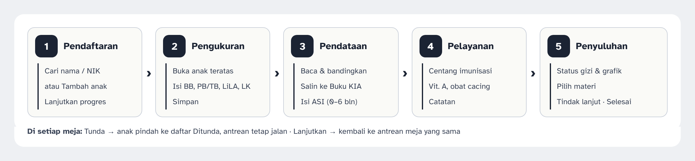
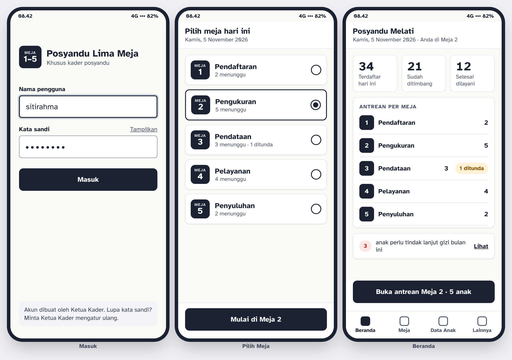
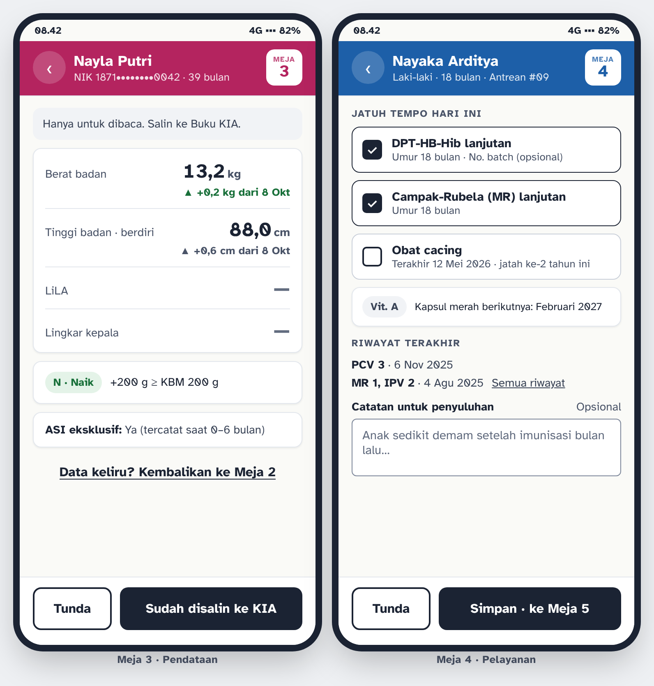
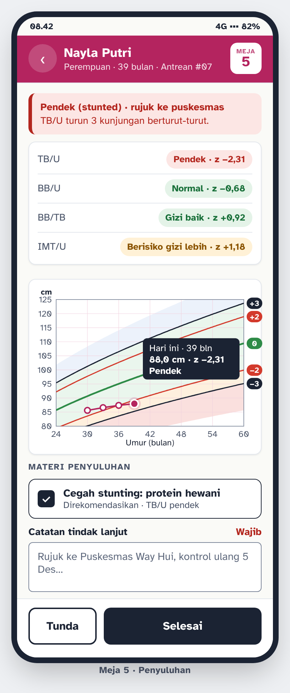
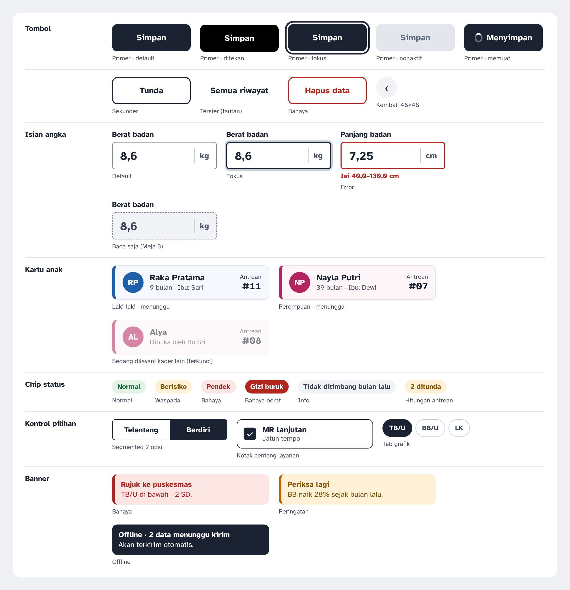
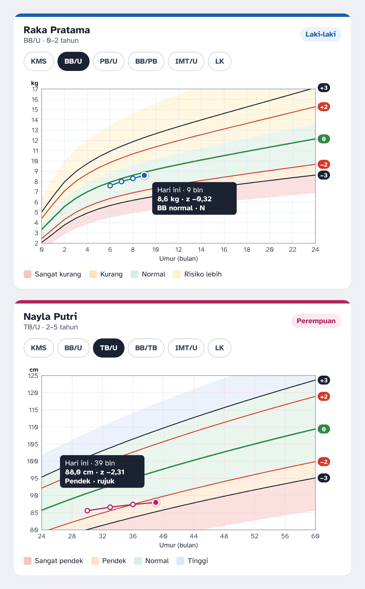
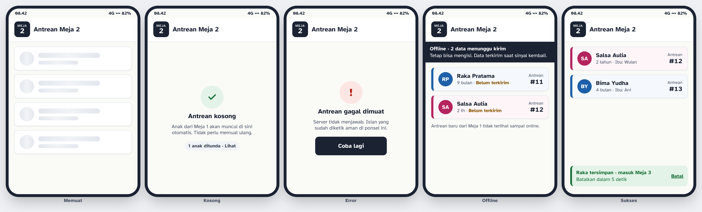
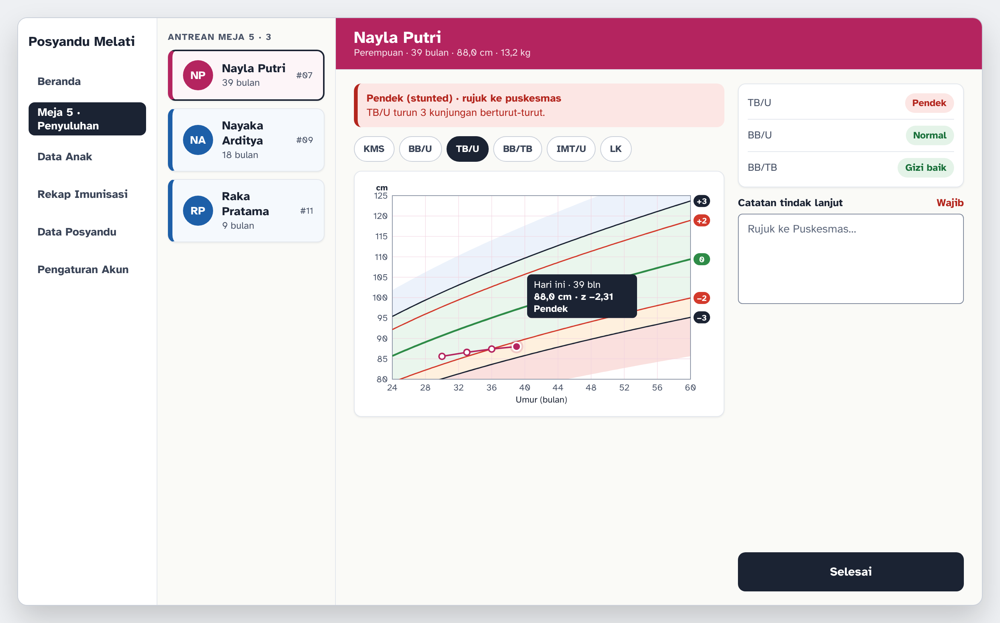

<!-- Dikonversi otomatis dari docs/sumber/Design_Brief_Sistem_Informasi_Posyandu_Lima_Meja.docx tanpa mengubah isi. Jika berbeda, berkas .docx yang berlaku. -->

| DESIGN BRIEF   Sistem Informasi   Posyandu Lima Meja   Arah desain antarmuka sebelum pengembangan dimulai |
|---|

| Versi | 1.0 |
|---|---|
| Tanggal | 3 November 2026 |
| Status | Draf untuk ditinjau |
| Disusun oleh | Senior Product Designer |
| Dasar | PRD Sistem Informasi Posyandu Lima Meja versi 1.0 |

Riwayat Revisi

| Versi | Tanggal | Keterangan |
|---|---|---|
| 1.0 | 3 November 2026 | Design brief awal berdasarkan PRD versi 1.0. Seluruh mockup dan grafik dibuat ulang dengan token desain dalam dokumen ini. |

Daftar Isi

- Ringkasan Keputusan … 4

- 1. Prinsip Desain … 4

- Prinsip 1. Satu meja, satu tugas, satu tombol utama … 4

- Prinsip 2. Angka dulu, dan angka harus terbaca di bawah matahari … 5

- Prinsip 3. Warna adalah makna, bukan hiasan … 5

- 2. Arah Visual … 5

- 2.1 Suasana … 5

- 2.2 Referensi … 6

- 2.3 Yang Dihindari … 6

- 3. Design Tokens … 7

- 3.1 Warna Netral dan Aksi … 7

- 3.2 Warna Identitas Anak … 7

- 3.3 Warna Status Gizi … 8

- 3.4 Warna Grafik Pertumbuhan … 9

- 3.5 Tipografi … 9

- 3.6 Spasi, Ukuran Sentuh, Radius, dan Bayangan … 11

- 4. Inventaris Layar … 12

- 5. Alur Pengguna … 13

- 5.1 Memulai Hari … 13

- 5.2 Mendaftarkan Anak Baru (Meja 1) … 14

- 5.3 Melanjutkan Progres Anak Terdaftar (Meja 1) … 14

- 5.4 Mengukur Anak (Meja 2) … 15

- 5.5 Mendata ke Buku KIA (Meja 3) … 15

- 5.6 Memberi Layanan (Meja 4) … 16

- 5.7 Penyuluhan dan Menyelesaikan Kunjungan (Meja 5) … 16

- 5.8 Menunda dan Melanjutkan … 17

- 5.9 Memindahkan Riwayat dari Buku KIA … 17

- 5.10 Mengunduh CSV dan Mengelola Akun … 17

- 6. Tata Letak per Layar … 18

- 6.1 Masuk, Pilih Meja, dan Beranda … 18

- 6.2 Meja 1 dan Meja 2 … 20

- 6.3 Meja 3 dan Meja 4 … 21

- 6.4 Meja 5 Penyuluhan … 23

- 6.5 Data Anak, Rekap, Data Posyandu, dan Pengaturan … 24

- 7. Pustaka Komponen … 25

- 7.1 Komponen Grafik Pertumbuhan … 28

- 8. State Layar … 29

- 9. Perilaku Responsif … 31

- 10. Aksesibilitas … 32

- 10.1 Rasio Kontras … 33

- 10.2 Urutan Fokus … 33

- 10.3 Navigasi Keyboard (Tablet dan Desktop) … 33

- 10.4 Kebutuhan ARIA dan Semantik … 34

# Ringkasan Keputusan

Antarmuka ini dirancang untuk kader yang berdiri di meja posyandu, memegang ponsel dengan satu tangan, sering di bawah tenda atau di teras yang terang, sambil melayani ibu yang menggendong anak. Semua keputusan di bawah berangkat dari kondisi itu, bukan dari selera visual.

Tabel 1. Enam keputusan desain utama

| Keputusan | Alasan singkat |
|---|---|
| Tombol utama berwarna merek plum (#6B3B52), bukan biru atau hijau | Biru sudah berarti anak laki-laki dan hijau berarti status normal. Warna aksi tidak boleh bentrok dengan makna data. |
| Font Plus Jakarta Sans untuk seluruh antarmuka | Bentuk huruf geometris yang lembut dan bersih, angka tegas dan mudah dibedakan, sejalan dengan bahasa visual prototipe "Posya App". Nyaman dibaca kader untuk NIK 16 digit dan angka ukur. |
| Latar kertas hangat #FAFAF7, bukan putih murni | Mengurangi silau di layar murah bertingkat kecerahan tinggi, dan permukaan kartu putih tetap terpisah tanpa bayangan tebal. |
| Satu layar meja, satu tombol utama di zona jempol | Kader bekerja cepat dengan satu tangan. Tombol Simpan selalu di posisi yang sama di bagian bawah. |
| Biru dan merah muda hanya untuk identitas jenis kelamin anak | Mengikuti Buku KIA sehingga kader langsung mengenali grafik dan kartu yang benar, tanpa belajar kode warna baru. |
| Grafik pertumbuhan dengan dua zona warna di belakang garis z-score | Kader membaca posisi anak dalam sekali lihat: hijau berarti aman, merah berarti tidak aman. Kategori rinci tetap ada di teks. |

# 1. Prinsip Desain

Tiga prinsip berikut wajib dipatuhi. Jika sebuah usulan layar melanggar salah satunya, usulan itu dikembalikan ke desain sebelum dikerjakan.

## Prinsip 1. Satu meja, satu tugas, satu tombol utama

Setiap layar kerja meja hanya memiliki satu tombol utama berwarna merek (plum), menempel di bagian bawah layar dalam jangkauan jempol. Tombol sekunder (biasanya Tunda) selalu berada di kiri tombol utama dengan ukuran lebih kecil. Kader tidak pernah perlu menggulir untuk menyimpan.

Alasannya: antrean posyandu bisa mencapai puluhan anak dalam dua sampai tiga jam. Posisi tombol yang selalu sama membuat gerakan kader menjadi kebiasaan, sehingga perhatiannya tetap pada anak dan angka, bukan mencari tombol.

- Uji cepat: jika satu layar memiliki dua tombol berwarna merek, desainnya salah.

- Dialog konfirmasi hanya dipakai untuk tindakan yang tidak bisa dibatalkan (hapus data). Tindakan lain memakai notifikasi dengan tombol Batal selama 5 detik.

## Prinsip 2. Angka dulu, dan angka harus terbaca di bawah matahari

Data utama aplikasi adalah angka: berat, panjang atau tinggi, lingkar lengan, lingkar kepala, z-score, dan NIK. Angka ukur ditampilkan 24 px tebal, satuan selalu menempel di sebelahnya, dan perubahan selalu memakai tanda (▲ +0,2 kg). Kontras teks angka minimal 7 : 1.

Alasannya: kesalahan membaca 8,5 sebagai 6,5 atau 13,2 sebagai 18,2 langsung mengubah status gizi anak. Isian menerima koma maupun titik sebagai desimal, sehingga kader tidak perlu memikirkan format.

## Prinsip 3. Warna adalah makna, bukan hiasan

Aplikasi memiliki anggaran warna yang tegas: biru dan merah muda hanya untuk identitas jenis kelamin anak, hijau, oranye, dan merah hanya untuk status gizi, warna merek plum hanya untuk aksi dan penanda aktif, serta warna tinta untuk teks dan data netral. Tidak ada warna lain. Setiap warna selalu disertai teks atau ikon, misalnya label "Perempuan" dan teks kategori "Pendek".

Alasannya: jika hijau juga dipakai sebagai warna tombol, kader bisa salah mengira anak berstatus normal. Teks pendamping memastikan informasi tetap terbaca oleh pengguna dengan buta warna dan pada hasil cetak hitam putih.

| KONSEKUENSI   Nomor meja tidak diberi warna berbeda. Meja dibedakan dengan lencana angka berwarna tinta, karena hijau, oranye, dan merah sudah terpakai untuk status gizi. |
|---|

# 2. Arah Visual

## 2.1 Suasana

Suasana yang dituju adalah register posyandu yang rapi: tenang, jelas, dan bisa dipercaya, seperti buku catatan bersih di meja kader. Warna latar kertas hangat dan teks tinta memberi kesan akrab, tidak dingin seperti aplikasi rumah sakit. Informasi boleh padat, tetapi setiap baris memiliki ruang napas yang cukup.

Tabel 2. Kata kunci suasana

| Kata kunci | Wujud di antarmuka |
|---|---|
| Tenang | Latar kertas, sedikit warna, tanpa animasi dekoratif. |
| Tegas | Teks tinta tebal, garis batas jelas, satu tombol utama per layar. |
| Bisa dipercaya | Angka besar dengan satuan, sumber standar ditampilkan pada grafik, status selalu dijelaskan dengan teks. |
| Akrab | Istilah dan warna sama dengan Buku KIA; bahasa Indonesia sehari-hari tanpa istilah teknis. |

## 2.2 Referensi

Tabel 3. Referensi visual dan yang diambil

| Referensi | Yang diambil |
|---|---|
| Buku KIA 2024 (halaman grafik pertumbuhan) | Kode warna biru untuk laki-laki dan merah muda untuk perempuan, warna garis z-score, istilah kategori status gizi. Kader tidak perlu mempelajari dua bahasa visual. |
| Prototipe "Posya App by OregonTeam" (Figma) | Kepala aplikasi plum yang menempel, kartu membulat, bilah navigasi bawah dengan penanda aktif, dan tombol utama besar. Bahasa visualnya disesuaikan; konsep Posyandu Lima Meja tidak berubah. |
| GOV.UK Design System | Pola formulir satu kolom, label di atas isian, pesan kesalahan tepat di bawah isian disertai ringkasan di atas, serta tombol berteks jelas. |
| Kartu register dan KMS kertas | Baris data bergaris tipis, label di kiri dan angka di kanan, sehingga mudah disalin ke buku. |

## 2.3 Yang Dihindari

- Tombol biru bawaan framework (Material atau Bootstrap), karena biru sudah berarti anak laki-laki.

- Gradien, glassmorphism, dan bayangan tebal, karena hilang atau tampak kotor di layar murah di bawah sinar matahari.

- Ilustrasi kartun ibu dan bayi atau foto stok di layar kerja; hanya membuang ruang di layar kecil.

- Ikon tanpa label dan menu hamburger; setiap navigasi memiliki teks.

- Teks abu-abu tipis dan warna pastel pucat yang tidak terbaca di luar ruangan.

- Carousel, slider, dan grafik donat yang menyembunyikan atau menyederhanakan data secara berlebihan.

- Mode gelap sebagai bawaan; posyandu berlangsung siang hari di tempat terang.

- Emoji dan animasi dekoratif.

# 3. Design Tokens

## 3.1 Warna Netral dan Aksi

Kolom kontras dihitung dengan rumus WCAG 2.2 terhadap latar yang tertulis.

Tabel 4. Token warna netral

| Token | Hex |  | Pemakaian | Kontras |
|---|---|---|---|---|
| ink-900 | #1B2333 |  | Teks utama, tombol utama, lencana meja | 15,0 : 1 di kertas |
| ink-700 | #3A4457 |  | Teks isi sekunder | 9,4 : 1 di kertas |
| ink-600 | #4A5468 |  | Label, keterangan, sumbu grafik | 7,3 : 1 di kertas |
| ink-500 | #626C7F |  | Placeholder, teks nonaktif | 5,1 : 1 di kertas |
| ink-400 | #7D879A |  | Garis tepi isian | 3,6 : 1 di putih |
| ink-300 | #C9CFD9 |  | Garis tepi kontrol nonaktif | Dekoratif |
| ink-200 | #E3E7ED |  | Garis pemisah, tepi kartu | Dekoratif |
| ink-100 | #F1F3F6 |  | Latar isian baca saja, chip info | Dekoratif |
| paper | #FAFAF7 |  | Latar halaman | – |
| white | #FFFFFF |  | Permukaan kartu dan isian | – |

Kenapa tinta, bukan hitam murni? Hitam #000000 di atas latar terang terasa keras dan memantulkan silau. Tinta biru keabu-abuan #1B2333 tetap memberi kontras di atas 15 : 1, tetapi lebih nyaman dibaca lama.

## 3.1.1 Warna Merek

Warna merek adalah plum hangat dari acuan prototipe "Posya App". Warnanya dipakai untuk aksi dan penanda aktif saja, tidak pernah untuk data. Ronanya sengaja dijauhkan dari merah muda identitas anak (girl-700 #B4245F) dan merah status bahaya (#B3261E) agar makna data tetap utuh.

Tabel 4b. Token warna merek

| Token | Hex | Pemakaian | Kontras |
|---|---|---|---|
| brand-900 | #3B1F2B | Teks merek di latar terang, aksen tergelap | 12,4 : 1 di putih |
| brand-800 | #4C2A3A | Tombol utama ditekan | 10,2 : 1 di putih |
| brand-700 | #6B3B52 | Tombol utama, kepala aplikasi, teks tab aktif | Putih: 8,8 : 1 |
| brand-600 | #8B4F69 | Penanda aktif navigasi bawah | 6,2 : 1 di putih |
| brand-300 | #D9A8BD | Garis dekoratif pada latar merek | Dekoratif |
| brand-200 | #E9CCD9 | Garis tepi lembut pada latar merek | Dekoratif |
| brand-100 | #F7E9EF | Latar kartu merek lembut | brand-700: 7,5 : 1 |
| brand-50 | #FCF6F9 | Latar sorot saat kursor di menu | Dekoratif |

## 3.2 Warna Identitas Anak

Tabel 5. Token warna jenis kelamin

| Token | Hex |  | Pemakaian | Kontras |
|---|---|---|---|---|
| boy-700 | #1D5FA8 |  | Header anak laki-laki, garis kartu, titik grafik | Putih: 6,5 : 1 |
| boy-100 | #EAF2FB |  | Lencana "Laki-laki", latar tab aktif | Teks boy-700: 5,7 : 1 |
| boy-50 | #F5F9FD |  | Latar kartu antrean laki-laki | Dekoratif |
| girl-700 | #B4245F |  | Header anak perempuan, garis kartu, titik grafik | Putih: 6,3 : 1 |
| girl-100 | #FBE8F0 |  | Lencana "Perempuan" | Teks girl-700: 5,3 : 1 |
| girl-50 | #FDF5F8 |  | Latar kartu antrean perempuan | Dekoratif |

Biru dan merah muda dipilih lebih gelap daripada warna halaman Buku KIA agar teks putih di atasnya lulus kontras AA. Merah muda sengaja dibuat ke arah magenta (#B4245F) supaya tidak tertukar dengan merah status bahaya (#B3261E): keduanya berbeda rona, dan merah bahaya selalu disertai teks kategori.

## 3.3 Warna Status Gizi

Tabel 6. Token warna status

| Status | Teks | Latar |  | Dipakai untuk | Kontras |
|---|---|---|---|---|---|
| Normal | #19703A | #E4F3E8 |  | Normal, gizi baik, status N | 5,3 : 1 |
| Waspada | #8A5300 | #FFF1D6 |  | Berisiko gizi lebih, risiko BB lebih, peringatan isian, data ditunda | 5,7 : 1 |
| Bahaya | #B3261E | #FCE6E4 |  | Kurang, pendek, gizi kurang, gizi lebih, status T, error | 5,5 : 1 |
| Bahaya berat | #FFFFFF | #B3261E |  | Sangat kurang, sangat pendek, gizi buruk, obesitas | 6,5 : 1 |
| Info | #3A4457 | #F1F3F6 |  | Keterangan netral, tidak ditimbang bulan lalu | 8,8 : 1 |

## 3.4 Warna Grafik Pertumbuhan

Tabel 7. Token warna garis dan zona grafik

| Elemen | Hex |  | Keterangan | Kontras |
|---|---|---|---|---|
| Garis 0 (median) | #2E8B47 |  | Tebal 2,4 px | 4,3 : 1 di putih |
| Garis ±1 | #B86200 |  | Tebal 1,6 px; hanya grafik BB/PB, BB/TB, IMT/U, LK | 4,4 : 1 di putih |
| Garis ±2 | #D33A2C |  | Tebal 1,6 px | 4,8 : 1 di putih |
| Garis ±3 | #1B2333 |  | Tebal 1,6 px | 15,7 : 1 di putih |
| Zona aman | #D9EFDF |  | Area di dalam batas normal (hijau) | Latar |
| Zona tidak aman | #F6C7C2 |  | Area di luar batas normal (merah) | Latar |

Warna garis mengikuti Buku KIA (hijau, oranye, merah, hitam) dan semuanya memenuhi kontras grafis minimal 3 : 1. Zona hanya memakai dua warna, hijau untuk aman dan merah untuk tidak aman, agar kader membaca posisi anak dalam sekali lihat. Nama kategori tetap ditulis di keterangan titik dan tabel, jadi warna bukan satu-satunya penanda. Zona digambar dengan opasitas 55 % agar garis dan titik anak tetap menjadi elemen paling menonjol.

## 3.5 Tipografi

Font: Plus Jakarta Sans (variable 200–800, lisensi SIL Open Font License, tersedia di Google Fonts), dipakai untuk seluruh antarmuka dan di-self-host sebagai subset Latin.

- Bentuk huruf geometris yang lembut dan bersih, sejalan dengan prototipe "Posya App". Sudut dan terminal huruf membulat sehingga antarmuka terasa ramah tanpa mengurangi ketegasan data.

- Jelas untuk data angka. Angka pada Plus Jakarta Sans memiliki tinggi dan bentuk yang tegas, sehingga NIK 16 digit dan angka ukur seperti 8,5 atau 13,2 mudah dibaca dan disalin ke Buku KIA.

- Ringan. Satu berkas variable woff2 subset Latin sekitar 27 KB sudah mencakup bobot 200 sampai 800, sehingga cepat dimuat di jaringan seluler.

- Kenapa bukan Inter atau Roboto? Keduanya sangat umum dan rapi, tetapi tidak memberi identitas visual seperti yang diminta prototipe. Plus Jakarta Sans juga dirancang untuk antarmuka digital dan terbaca baik pada ukuran kecil.

Urutan font cadangan: Plus Jakarta Sans, system-ui, "Segoe UI", Roboto, sans-serif. Ukuran dasar 16 px; tidak ada teks penting di bawah 13 px, kecuali label sumbu grafik yang minimal 12 px.

Tabel 8. Skala tipografi

| Gaya | Ukuran / tinggi baris | Bobot | Pemakaian |
|---|---|---|---|
| Display | 28 / 34 px | Bold | Judul status kosong, angka besar Beranda |
| Judul 1 | 22 / 28 px | Bold | Nama anak di header, judul halaman desktop |
| Judul 2 | 18 / 24 px | Bold | Judul layar ponsel, judul kartu |
| Angka ukur | 24 / 28 px | Bold | Nilai BB, PB/TB, LiLA, LK di isian dan Meja 3 |
| Teks | 16 / 24 px | Regular | Isi umum, nilai isian teks |
| Teks tebal | 16 / 24 px | Bold | Tombol, nama di kartu |
| Kecil | 14 / 20 px | Regular | Label isian (Bold), info sekunder |
| Keterangan | 13 / 18 px | Regular | Petunjuk isian, nilai sebelumnya, pesan error (Bold) |
| Label seksi | 12 / 16 px | Bold, huruf kapital, spasi 0,08 em | Judul kelompok seperti ANTREAN PER MEJA |

Gambar 1. Spesimen skala tipografi dengan Plus Jakarta Sans

## 3.6 Spasi, Ukuran Sentuh, Radius, dan Bayangan

Tabel 9. Skala spasi (basis 4 px)

| Token | Nilai | Pemakaian |
|---|---|---|
| space-1 | 4 px | Jarak ikon ke teks, jarak label ke petunjuk |
| space-2 | 8 px | Jarak antartombol, jarak di dalam chip |
| space-3 | 12 px | Jarak antarkartu di daftar, padding kartu vertikal |
| space-4 | 16 px | Margin tepi layar ponsel, jarak antarisian, padding kartu horizontal |
| space-5 | 24 px | Margin tepi tablet, jarak antarseksi |
| space-6 | 32 px | Margin tepi desktop |
| space-7 | 48 px | Ruang kosong di status kosong dan layar masuk |

Tabel 10. Ukuran, radius, dan bayangan

| Token | Nilai | Pemakaian dan alasan |
|---|---|---|
| target-min | 48 × 48 px | Area sentuh minimal, lebih besar dari anjuran 44 px karena kader sering memakai ibu jari sambil berdiri. |
| control-h | 52 px | Tinggi tombol utama dan isian. |
| radius-sm | 8 px | Isian, kontrol segmen. |
| radius-md | 14 px | Tombol, banner, lencana meja, bilah navigasi. |
| radius-lg | 20 px | Kartu, bottom sheet, dan dialog. |
| radius-pill | 999 px | Chip status, tab pil, penanda aktif. |
| shadow-1 | 0 1px 2px rgba(59,31,43,0,06), 0 2px 6px rgba(59,31,43,0,06) | Kartu. Sangat tipis karena pemisahan utama memakai garis tepi ink-200. |
| shadow-2 | 0 8px 24px rgba(59,31,43,0,16) | Kepala aplikasi, bottom sheet, notifikasi melayang. |
| motion | 150 ms ease-out; 250 ms untuk sheet | Hanya untuk perubahan keadaan. Dimatikan jika pengguna memilih kurangi gerak. |

| KENAPA BAYANGAN NYARIS TIDAK DIPAKAI   Di bawah sinar matahari, bayangan halus tidak terlihat. Pemisahan permukaan memakai kombinasi latar kertas, kartu putih, dan garis tepi 1 px, yang tetap terbaca dalam kondisi terang. |
|---|

# 4. Inventaris Layar

Tabel 11. Daftar layar dan tujuannya

| ID | Layar | Tujuan | Pengguna |
|---|---|---|---|
| S01 | Masuk | Masuk dengan nama pengguna dan kata sandi buatan Ketua Kader. | Semua kader |
| S02 | Pilih Meja | Menetapkan meja yang dipegang hari ini sebelum bekerja. | Semua kader |
| S03 | Beranda | Melihat ringkasan hari ini dan antrean per meja, lalu masuk ke meja sendiri. | Semua kader |
| S04 | Meja 1: Pendaftaran | Memilih Tambah anak baru atau Lanjutkan progres anak. | Kader Meja 1 |
| S05 | Tambah Anak | Mengisi identitas anak, orang tua, alamat, dan ukuran terakhir dari Buku KIA. | Kader Meja 1 |
| S06 | Cari Anak | Menemukan anak terdaftar dengan nama atau NIK lalu memasukkannya ke antrean. | Kader Meja 1 |
| S07 | Anak Tersimpan | Memilih lanjut ke antrean Meja 2 atau kembali ke awal. | Kader Meja 1 |
| S08 | Antrean Meja (2–5) | Melihat anak yang menunggu dan ditunda, lalu membuka anak berikutnya. | Kader Meja 2–5 |
| S09 | Meja 2: Pengukuran | Mengisi BB, PB/TB, LiLA, LK. | Kader Meja 2 |
| S10 | Meja 3: Pendataan | Membaca hasil ukur dan perbandingannya untuk disalin ke Buku KIA; mengisi ASI eksklusif. | Kader Meja 3 |
| S11 | Meja 4: Pelayanan | Mencatat imunisasi, vitamin A, obat cacing, dan catatan. | Kader Meja 4 |
| S12 | Meja 5: Penyuluhan | Membaca status gizi dan grafik, memilih materi, mengisi tindak lanjut, menyelesaikan kunjungan. | Kader Meja 5 |
| S13 | Daftar Ditunda (sheet) | Melanjutkan anak yang ditunda di meja tersebut. | Kader Meja 1–5 |
| S14 | Data Anak | Mencari, menyaring, dan mengekspor daftar seluruh anak. | Semua kader |
| S15 | Detail Anak | Melihat identitas, grafik, dan riwayat kunjungan serta layanan. | Semua kader |
| S16 | Ubah Data Anak | Memperbaiki identitas, orang tua, dan alamat. | Semua kader |
| S17 | Tambah Riwayat dari Buku KIA | Memindahkan riwayat imunisasi dan pengukuran lama ke sistem. | Semua kader |
| S18 | Rekap Imunisasi | Melihat dan mengunduh rekap imunisasi per periode. | Semua kader |
| S19 | Data Posyandu | Melihat profil posyandu, daftar kader, rekap SKDN dan status gizi, lalu mengunduh CSV. | Semua kader |
| S20 | Lainnya | Menu sekunder: Rekap Imunisasi, Data Posyandu, Pengaturan Akun, Ganti Meja, Keluar. | Semua kader |
| S21 | Pengaturan Akun | Membuat, menonaktifkan, dan mengatur ulang kata sandi akun kader. | Ketua Kader |
| S22 | Sesi Berakhir | Meminta masuk ulang setelah 2 jam tanpa aktivitas tanpa kehilangan isian. | Semua kader |

# 5. Alur Pengguna

Gambar berikut merangkum perjalanan satu kunjungan anak melewati lima meja. Rincian setiap alur ditulis dalam tabel langkah kader dan respons sistem.

Gambar 2. Perjalanan satu kunjungan melewati lima meja

## 5.1 Memulai Hari

Tabel 12. Alur memulai hari

| No | Langkah kader | Respons sistem |
|---|---|---|
| 1 | Membuka aplikasi dan mengisi nama pengguna serta kata sandi, lalu menekan Masuk. | Memeriksa akun. Jika salah, menampilkan pesan umum di bawah tombol tanpa menyebut bagian yang salah. |
| 2 | Memilih meja yang dipegang hari ini, lalu menekan Mulai di Meja N. | Menyimpan pilihan meja untuk sesi ini dan membuka Beranda. |
| 3 | Membaca ringkasan hari ini dan menekan Buka antrean Meja N. | Membuka layar meja dengan antrean yang diperbarui otomatis. |

## 5.2 Mendaftarkan Anak Baru (Meja 1)

Tabel 13. Alur anak baru

| No | Langkah kader | Respons sistem |
|---|---|---|
| 1 | Menekan Tambah anak baru. | Membuka formulir satu halaman dengan empat seksi: Identitas anak, Orang tua, Alamat, Ukuran terakhir dari Buku KIA (terlipat). |
| 2 | Mengisi isian wajib, memilih jenis kelamin. | Begitu jenis kelamin dipilih, header formulir berubah biru atau merah muda. |
| 3 | Menekan Simpan data. | Memeriksa NIK unik dan kemiripan data. Jika ada data mirip, menampilkan kartu anak tersebut dengan pilihan Pakai data ini atau Tetap simpan baru. |
| 4 | Memilih Lanjutkan ke Meja 2. | Membuka kunjungan hari ini, memberi nomor antrean, kembali ke layar awal Meja 1, dan menampilkan notifikasi dengan tombol Batal. |

## 5.3 Melanjutkan Progres Anak Terdaftar (Meja 1)

Tabel 14. Alur anak terdaftar

| No | Langkah kader | Respons sistem |
|---|---|---|
| 1 | Mengetik minimal tiga huruf nama, atau NIK anak atau ibu. | Menampilkan hasil secara langsung sebagai kartu berwarna sesuai jenis kelamin, NIK tersamar. |
| 2 | Mengetuk kartu anak yang benar. | Menampilkan ringkasan anak dan tombol Lanjutkan progres serta Cari kembali. |
| 3 | Menekan Lanjutkan progres. | Memasukkan anak ke antrean Meja 2. Anak yang sudah ada di antrean hari ini ditampilkan redup dan tidak dapat dipilih. |

## 5.4 Mengukur Anak (Meja 2)

Tabel 15. Alur pengukuran

| No | Langkah kader | Respons sistem |
|---|---|---|
| 1 | Mengetuk anak teratas di antrean. | Mengunci anak untuk kader ini dan membuka formulir dengan header berwarna sesuai jenis kelamin. |
| 2 | Mengisi BB, lalu PB/TB. Cara ukur sudah terisi sesuai umur. | Menampilkan keyboard angka, menerima koma atau titik, dan menampilkan nilai kunjungan lalu di bawah isian. |
| 3 | Mengisi LiLA dan LK bila diukur. | Memeriksa batas wajar saat isian ditinggalkan. Perubahan ekstrem memunculkan banner Periksa lagi tanpa memblokir. |
| 4 | Menekan Simpan · ke Meja 3. | Menyimpan, memindahkan anak ke antrean Meja 3, membuka kembali antrean Meja 2. |

## 5.5 Mendata ke Buku KIA (Meja 3)

Tabel 16. Alur pendataan

| No | Langkah kader | Respons sistem |
|---|---|---|
| 1 | Membuka anak dari antrean. | Menampilkan nilai ukur dalam mode baca saja, besar dan rata kanan, beserta perbandingan dengan kunjungan lalu dan status N/T. |
| 2 | Menyalin angka ke Buku KIA; mengisi ASI eksklusif bila anak 0–6 bulan. | Pilihan ASI eksklusif hanya muncul untuk umur 0–6 bulan. |
| 3 | Menekan Sudah disalin ke KIA. | Memindahkan anak ke antrean Meja 4. |
| 3a | Jika angka keliru, menekan Kembalikan ke Meja 2 dan menulis alasan singkat. | Mengembalikan anak ke antrean Meja 2 dengan tanda "Perlu ukur ulang". |

## 5.6 Memberi Layanan (Meja 4)

Tabel 17. Alur pelayanan

| No | Langkah kader | Respons sistem |
|---|---|---|
| 1 | Membuka anak dari antrean. | Menampilkan layanan jatuh tempo hari ini dalam keadaan tercentang, serta dua riwayat imunisasi terakhir. |
| 2 | Menghapus centang layanan yang tidak jadi diberikan; mengisi nomor batch bila ada. | Tanggal pemberian otomatis hari ini dan dapat diubah. |
| 3 | Menulis catatan untuk penyuluhan bila perlu, lalu menekan Simpan · ke Meja 5. | Menyimpan layanan ke riwayat dan memindahkan anak ke antrean Meja 5. |

## 5.7 Penyuluhan dan Menyelesaikan Kunjungan (Meja 5)

Tabel 18. Alur penyuluhan

| No | Langkah kader | Respons sistem |
|---|---|---|
| 1 | Membuka anak dari antrean. | Menampilkan banner risiko paling serius di atas, lalu status gizi per indeks dan grafik indeks yang paling bermasalah. |
| 2 | Menunjukkan grafik kepada ibu; berganti tab untuk indeks lain. | Grafik memuat titik kunjungan lalu dan hari ini serta keterangan nilai dan kategori. |
| 3 | Memilih materi penyuluhan yang direkomendasikan atau menambah materi lain. | Materi tersusun sesuai kondisi anak. Edukasi Isi Piringku ibu menyusui muncul untuk anak di bawah 24 bulan. |
| 4 | Mengisi catatan tindak lanjut, lalu menekan Selesai. | Tombol Selesai aktif setelah catatan diisi bila ada status di luar normal. Kunjungan berstatus Selesai dan angka Beranda bertambah. |

## 5.8 Menunda dan Melanjutkan

Tabel 19. Alur tunda

| No | Langkah kader | Respons sistem |
|---|---|---|
| 1 | Menekan Tunda di layar meja mana pun. | Menyimpan isian yang sudah diketik, memindahkan anak ke daftar Ditunda meja tersebut, lalu membuka anak berikutnya. |
| 2 | Saat anak siap, membuka chip "N ditunda" di atas antrean. | Membuka sheet Daftar Ditunda dengan lama penundaan. |
| 3 | Menekan Lanjutkan pada anak tersebut. | Mengembalikan anak ke antrean meja yang sama beserta isian sebelumnya. |

## 5.9 Memindahkan Riwayat dari Buku KIA

Tabel 20. Alur input riwayat

| No | Langkah kader | Respons sistem |
|---|---|---|
| 1 | Membuka Data Anak, mencari anak, membuka detailnya. | Menampilkan detail dengan tab Ringkasan, Grafik, dan Riwayat. |
| 2 | Di tab Riwayat menekan Tambah dari Buku KIA, memilih Imunisasi atau Pengukuran. | Membuka formulir singkat: jenis vaksin dan tanggal, atau tanggal dan empat ukuran. |
| 3 | Menyimpan; mengulang untuk entri berikutnya. | Entri bertanda "Dari Buku KIA", langsung dipakai untuk rekomendasi imunisasi dan grafik. |

## 5.10 Mengunduh CSV dan Mengelola Akun

Tabel 21. Alur unduh dan akun

| No | Langkah kader | Respons sistem |
|---|---|---|
| 1 | Di Data Anak, Rekap Imunisasi, atau Data Posyandu, mengatur penyaring lalu menekan Unduh CSV. | Membuat berkas sesuai penyaring dan menampilkan notifikasi beserta nama berkasnya. |
| 2 | Ketua Kader membuka Lainnya > Pengaturan Akun > Tambah kader. | Membuka formulir nama, nama pengguna, dan kata sandi awal. |
| 3 | Menyimpan akun baru atau menekan Atur ulang kata sandi pada akun yang ada. | Menampilkan kata sandi sementara sekali untuk diberikan langsung kepada kader. |

# 6. Tata Letak per Layar

Setiap layar dijelaskan dari atas ke bawah. Mockup berikut dibuat ulang memakai token pada bab 3 dan data fiktif. Setiap layar setelah masuk diawali kepala aplikasi plum yang menempel (nama aplikasi dan meja yang dipegang).

## 6.1 Masuk, Pilih Meja, dan Beranda

Gambar 3. Masuk, Pilih Meja, dan Beranda di ponsel

S01 · Masuk

Aksi utama: Masuk.

Tabel 22. Susunan Masuk

| No | Bagian | Isi dan komponen |
|---|---|---|
| 1 | Identitas | Logo merek dan nama aplikasi; teks "Khusus kader posyandu". |
| 2 | Formulir | Isian nama pengguna; isian kata sandi dengan tautan Tampilkan. |
| 3 | Aksi | Tombol utama Masuk, lebar penuh. |
| 4 | Bantuan | Banner info: akun dibuat oleh Ketua Kader. Tidak ada tautan daftar akun. |

S02 · Pilih Meja

Aksi utama: Mulai di Meja N.

Tabel 23. Susunan Pilih Meja

| No | Bagian | Isi dan komponen |
|---|---|---|
| 1 | Header | Judul dan tanggal hari ini. |
| 2 | Daftar meja | Lima kartu pilihan tunggal: lencana nomor meja, nama tahap, jumlah menunggu dan ditunda. Meja terakhir yang dipakai terpilih otomatis. |
| 3 | Kaki | Tombol utama menempel di bawah dengan nama meja terpilih. |

S03 · Beranda

Aksi utama: Buka antrean meja sendiri.

Tabel 24. Susunan Beranda

| No | Bagian | Isi dan komponen |
|---|---|---|
| 1 | Hero | Bilah merek plum "Layanan Posyandu" berisi tanggal hari ini, dengan hiasan ilustrasi samar; mengikuti acuan prototipe "Posya App". |
| 2 | Identitas | Panel plum dengan tiga baris label dan kotak putih kapsul: kader, meja yang dipegang, dan nama posyandu. |
| 3 | Ringkasan | Tiga tile angka: terdaftar hari ini, sudah ditimbang, selesai dilayani. |
| 4 | Antrean per meja | Baris per meja: lencana, nama tahap, jumlah menunggu, chip jumlah ditunda. |
| 5 | Kaki | Tombol utama Buka antrean Meja N, lalu navigasi bawah: Beranda, Meja, Data Anak, Lainnya. |

## 6.2 Meja 1 dan Meja 2

Gambar 4. Meja 1 (cari anak), Meja 2 (pengukuran), dan validasi isian

S04–S06 · Meja 1

Aksi utama: Lanjutkan progres (setelah anak dipilih) atau Tambah anak baru.

Tabel 25. Susunan S04–S06 · Meja 1

| No | Bagian | Isi dan komponen |
|---|---|---|
| 1 | Header meja | Lencana Meja 1, judul, petunjuk pencarian. |
| 2 | Pencarian | Isian cari besar dengan tombol Hapus; hasil muncul saat mengetik. |
| 3 | Hasil | Kartu anak: avatar inisial berwarna jenis kelamin, nama, jenis kelamin dalam teks, umur, nama ibu, kunjungan terakhir. Anak yang sudah di antrean tampil redup. |
| 4 | Aksi | Tombol sekunder + Tambah anak baru di bawah; berubah menjadi tombol utama Lanjutkan progres setelah anak dipilih. |

S09 · Meja 2 Pengukuran

Aksi utama: Simpan · ke Meja 3.

Tabel 26. Susunan Meja 2 Pengukuran

| No | Bagian | Isi dan komponen |
|---|---|---|
| 1 | Header anak | Latar biru atau merah muda, tombol kembali, nama, jenis kelamin, umur, nomor antrean, lencana meja. |
| 2 | Berat badan | Isian angka dengan satuan kg dan petunjuk "Boleh pakai titik atau koma, contoh 8.5 atau 8,5 · Lalu: 13,0 kg". |
| 3 | Panjang/tinggi | Isian angka cm dan kontrol segmen Telentang/Berdiri. |
| 4 | LiLA dan LK | Isian angka bertanda Dianjurkan. |
| 5 | Kaki | Tunda (sekunder) dan Simpan · ke Meja 3 (utama). |

## 6.3 Meja 3 dan Meja 4

Gambar 5. Meja 3 (pendataan, baca saja) dan Meja 4 (pelayanan)

S10 · Meja 3 Pendataan

Aksi utama: Sudah disalin ke KIA.

Tabel 27. Susunan Meja 3 Pendataan

| No | Bagian | Isi dan komponen |
|---|---|---|
| 1 | Header anak | Nama, NIK tersamar, umur. |
| 2 | Pemberitahuan | Banner info "Hanya untuk dibaca. Salin ke Buku KIA." |
| 3 | Nilai ukur | Baris label–nilai: angka 24 px tebal rata kanan, perubahan bertanda ▲ atau ▼ dan tanggal kunjungan lalu. |
| 4 | Status | Chip N/T dengan perbandingan terhadap KBM; info ASI eksklusif. |
| 5 | Koreksi | Tautan Kembalikan ke Meja 2. |
| 6 | Kaki | Tunda dan Sudah disalin ke KIA. |

S11 · Meja 4 Pelayanan

Aksi utama: Simpan · ke Meja 5.

Tabel 28. Susunan Meja 4 Pelayanan

| No | Bagian | Isi dan komponen |
|---|---|---|
| 1 | Header anak | Nama, umur, nomor antrean. |
| 2 | Jatuh tempo | Kotak centang layanan berisi nama vaksin, alasan (umur), dan isian batch opsional. |
| 3 | Vitamin A dan obat cacing | Kotak centang atau info jadwal berikutnya bila belum waktunya. |
| 4 | Riwayat | Dua riwayat imunisasi terakhir dan tautan Semua riwayat. |
| 5 | Catatan | Isian catatan untuk penyuluhan. |
| 6 | Kaki | Tunda dan Simpan · ke Meja 5. |

## 6.4 Meja 5 Penyuluhan

Gambar 6. Meja 5: status gizi, grafik, materi, dan tindak lanjut

S12 · Meja 5 Penyuluhan

Aksi utama: Selesai.

Tabel 29. Susunan Meja 5 Penyuluhan

| No | Bagian | Isi dan komponen |
|---|---|---|
| 1 | Header anak | Nama, jenis kelamin, umur, nomor antrean. |
| 2 | Banner risiko | Hanya muncul bila ada status bahaya, stunting, atau prediksi berisiko; berisi kategori dan tindakan. |
| 3 | Status gizi | Baris per indeks dengan chip kategori dan z-score; urutan: indeks paling bermasalah di atas. |
| 4 | Grafik | Tab KMS, BB/U, PB/U atau TB/U, BB/PB atau BB/TB, IMT/U, LK; tab pertama yang terbuka adalah indeks paling bermasalah. |
| 5 | Edukasi | Kotak centang materi yang direkomendasikan, tombol tambah materi, kartu Isi Piringku ibu menyusui bila relevan. |
| 6 | Tindak lanjut | Isian catatan, bertanda Wajib bila ada status di luar normal. |
| 7 | Kaki | Tunda dan Selesai. |

## 6.5 Data Anak, Rekap, Data Posyandu, dan Pengaturan

Tabel 30. Susunan layar menu

| Layar | Susunan dari atas | Aksi utama |
|---|---|---|
| S14 Data Anak | Ringkasan semua anak (total, laki-laki, perempuan, belum ditimbang bulan ini) yang tidak mengikuti penyaring; kartu "Cari & saring" berisi isian cari dan chip penyaring jenis kelamin, kelompok umur, dusun; jumlah hasil; daftar kartu anak dengan hasil ukur terakhir, status imunisasi, dan aksi cepat Lihat grafik & KMS; tombol Unduh CSV di header. | Membuka detail anak |
| S15 Detail Anak | Header anak berwarna; tab Ringkasan (identitas, orang tua, alamat), Grafik (komponen grafik penuh), Riwayat (kunjungan dan layanan). Tab awal dapat dipesan lewat alamat ?tab=, dipakai aksi cepat Lihat grafik & KMS dari daftar. | Ubah data |
| S17 Tambah Riwayat | Pilihan Imunisasi atau Pengukuran; isian tanggal dan nilai; daftar entri yang baru ditambahkan. | Simpan entri |
| S18 Rekap Imunisasi | Penyaring periode, vaksin, dusun; tile cakupan per vaksin; tabel anak × vaksin yang dapat digulir horizontal. | Unduh CSV |
| S19 Data Posyandu | Kartu profil; tabel SKDN bulan berjalan dengan persentase D/S dan N/D; jumlah per status gizi; daftar kader. | Unduh CSV |
| S21 Pengaturan Akun | Daftar akun dengan status aktif; tombol Tambah kader; pada setiap akun: Atur ulang kata sandi dan Nonaktifkan. | Tambah kader |

# 7. Pustaka Komponen

Seluruh layar dibangun dari komponen berikut. Komponen baru hanya ditambahkan bila tidak bisa dibentuk dari varian yang ada.

Gambar 7. Komponen inti beserta varian dan state-nya

Tabel 31. Daftar komponen

| Komponen | Varian | State | Aturan |
|---|---|---|---|
| Kepala aplikasi | Satu | Tetap | Bilah merek plum (56/64 px) menempel di atas konten; berisi nama aplikasi dan meja yang dipegang. |
| Kartu | Satu | – | Permukaan putih, garis tepi ink-200, radius 20 px, bayangan tipis; label seksi memakai warna merek. |
| Tombol | Utama, Sekunder, Tersier (tautan), Bahaya, Ikon kembali | Default, ditekan, fokus, nonaktif, memuat | Tinggi 52 px; satu tombol utama per layar; teks berupa kata kerja; saat memuat teks berganti "Menyimpan…" dan tombol tidak bisa ditekan ulang. |
| Isian teks | Teks, cari, kata sandi, area teks | Default, fokus, error, nonaktif, baca saja | Kotak putih berbentuk kapsul dengan tepi ink-400 dan bayangan tipis; area teks memakai radius 20 px. Label di atas, bukan placeholder; petunjuk dan error di bawah. |
| Isian angka | Dengan satuan (kg, cm), tanpa satuan (NIK, HP) | Default, fokus, error, peringatan, baca saja | Bingkai kapsul seperti isian teks; inputmode desimal; menerima koma dan titik; nilai lalu tampil di petunjuk. |
| Kontrol segmen | 2–3 opsi | Terpilih, tidak terpilih, fokus | Bingkai kapsul mengikuti kotak isian. Dipakai untuk Telentang/Berdiri, Laki-laki/Perempuan, Ya/Tidak. Pilihan jenis kelamin memakai warna identitas anak (biru/pink). |
| Kotak centang layanan | Jatuh tempo, kejar, opsional | Tercentang, kosong, nonaktif | Seluruh kartu dapat diketuk; memuat nama layanan dan alasannya. |
| Kartu anak | Laki-laki, perempuan | Menunggu, sedang dilayani kader lain, ditunda, belum terkirim | Garis kiri 6 px dan avatar berwarna; jenis kelamin juga ditulis dalam teks; nomor antrean di kanan. |
| Kartu hasil anak | Laki-laki, perempuan | Sudah diantre, dipilih | Garis kiri 6 px, avatar berwarna, NIK tersamar, kunjungan terakhir. Pada daftar Data Anak dapat ditambah hasil ukur terakhir, chip status imunisasi, dan aksi cepat; seluruh isi identitas menjadi tautan ke detail bila tautan tersedia. |
| Header anak | Laki-laki, perempuan | – | Latar 700 dengan teks putih; berisi kembali, nama, umur, antrean, lencana meja. |
| Lencana meja | Besar (44 px), kecil (34 px) | – | Selalu berwarna tinta dengan angka putih. |
| Chip status | Normal, waspada, bahaya, bahaya berat, info | – | Selalu berisi teks kategori; bukan tombol. |
| Banner | Bahaya, peringatan, sukses, info, offline | Tetap, dapat ditutup | Judul tebal satu baris dan penjelasan; garis kiri 5 px. |
| Notifikasi (toast) | Sukses dengan Batal, error dengan Coba lagi | Muncul 5 detik, dapat ditutup | Muncul di atas kaki layar, tidak menutupi tombol utama. |
| Tile angka | Ringkasan Beranda, ringkasan Data Anak, cakupan rekap | Normal, memuat | Angka 28 px tebal dan label dua baris maksimal. |
| Baris nilai | Dengan perubahan, tanpa perubahan | Ada nilai, kosong (—) | Label kiri, nilai kanan; perubahan memakai ▲ ▼ dan warna ink-600. |
| Tab grafik | 6 tab sesuai indeks | Aktif, tidak aktif, fokus | Dapat digulir horizontal di ponsel. |
| Grafik pertumbuhan | Laki-laki, perempuan × 11 jenis grafik | Memuat, satu titik, banyak titik, perlu ukur ulang | Lihat bagian 7.1. |
| Navigasi | Bawah (ponsel), samping (tablet, desktop) | Aktif, tidak aktif | Empat tujuan dengan ikon dan teks; tujuan aktif memakai warna merek dan penanda garis. |
| Sheet bawah | Daftar ditunda, filter, konfirmasi | Terbuka, tertutup | Radius 20 px; dapat ditutup dengan geser atau tombol Tutup. |
| Dialog | Konfirmasi hapus | Terbuka | Hanya untuk tindakan permanen; tombol Bahaya di kanan, Batal di kiri. |
| Kerangka (skeleton) | Kartu, baris, grafik | Memuat | Menggantikan spinner layar penuh. |

## 7.1 Komponen Grafik Pertumbuhan

Grafik digambar ulang oleh aplikasi dari tabel standar, mengikuti susunan grafik pada PRD dan Buku KIA, dengan dua zona warna (hijau aman, merah tidak aman) agar kader membaca posisi anak dalam sekali lihat.

Gambar 8. Komponen grafik pertumbuhan: laki-laki BB/U 0–2 tahun dan perempuan TB/U 2–5 tahun

Tabel 32. Anatomi grafik pertumbuhan

| Elemen | Spesifikasi |
|---|---|
| Kepala kartu | Garis atas 6 px warna jenis kelamin, nama anak, indeks dan rentang umur, lencana jenis kelamin. |
| Tab indeks | KMS, BB/U, PB/U atau TB/U, BB/PB atau BB/TB, IMT/U, LK. Label PB atau TB mengikuti umur anak. |
| Zona latar | Dua warna sesuai token 3.4: hijau untuk area di dalam batas normal, merah untuk di luar batas normal, opasitas 55 %. |
| Garis z-score | Warna Buku KIA; BB/U dan PB/U atau TB/U memakai garis −3, −2, 0, +2, +3; indeks lain menambah ±1. |
| Label garis | Pil kecil di ujung kanan berisi 0, +2, −3, dan seterusnya dengan warna garisnya. |
| Titik anak | Kunjungan lalu: lingkaran putih bergaris warna jenis kelamin. Hari ini: lingkaran penuh dengan halo. Dihubungkan garis 2 px. |
| Keterangan | Kotak tinta berisi umur, nilai, z-score, dan kategori; muncul untuk titik hari ini dan saat titik lain disentuh. |
| Sumbu | Rentang sama dengan grafik Buku KIA; label minimal 12 px; satuan di atas sumbu Y. |
| Legenda | Di bawah grafik: dua kotak warna, "Aman" (hijau) dan "Tidak aman" (merah), disertai catatan batas mengikuti Buku KIA. |
| Alternatif tabel | Tombol "Lihat sebagai tabel" menampilkan tanggal, umur, nilai, z-score, dan kategori setiap kunjungan. |

# 8. State Layar

State berikut wajib dirancang sebelum layar dianggap selesai. Kesalahan jaringan tidak boleh menghapus isian yang sudah diketik kader.

Gambar 9. State memuat, kosong, error, offline, dan sukses pada antrean meja

Tabel 33. State layar kunci

| Layar | State | Tampilan dan perilaku |
|---|---|---|
| Masuk | Memuat | Tombol Masuk berganti "Memeriksa…" |
|  | Error | Pesan umum di bawah tombol; terkunci 15 menit setelah 5 kali gagal |
|  | Sukses | Langsung ke Pilih Meja |
|  | Offline | Banner: perlu internet untuk masuk pertama kali |
| Beranda | Memuat | Tile dan baris kerangka |
|  | Kosong | Angka 0 dan teks "Belum ada kunjungan hari ini" |
|  | Error | Banner error dengan Coba lagi; angka terakhir tetap tampil dengan jam pembaruan |
|  | Offline | Banner offline; angka diberi keterangan "per pukul 08.40" |
| Antrean meja | Memuat | Empat kartu kerangka |
|  | Kosong | Ikon centang, "Antrean kosong", chip jumlah ditunda |
|  | Error | Layar error dengan Coba lagi; isian lokal aman |
|  | Sukses | Notifikasi "Raka tersimpan · masuk Meja 3" dengan Batal |
|  | Offline | Banner gelap, kartu bertanda "Belum terkirim" |
| Meja 1 cari | Memuat | Baris kerangka di bawah isian |
|  | Kosong | "Tidak ditemukan" dan tombol Tambah anak baru |
|  | Error | Pesan di bawah isian dengan Coba lagi |
|  | Sukses | Anak masuk antrean, layar kembali ke awal |
|  | Offline | Pencarian memakai data tersimpan di perangkat; pendaftaran baru ditandai menunggu kirim |
| Formulir Meja 2–5 | Memuat | Tombol utama "Menyimpan…" dan nonaktif |
|  | Error | Ringkasan error di atas dan pesan di setiap isian; fokus pindah ke ringkasan |
|  | Sukses | Notifikasi dengan Batal 5 detik |
|  | Offline | Tetap bisa simpan; data masuk antrean kirim |
| Meja 5 grafik | Memuat | Kerangka grafik |
|  | Kosong | Satu titik dan teks "Kunjungan pertama, belum ada perbandingan" |
|  | Error | Status gizi tidak dihitung; banner "Perlu ukur ulang" |
|  | Sukses | Kunjungan Selesai dan kembali ke antrean |
|  | Offline | Grafik dihitung di perangkat dari tabel standar yang tersimpan |
| Data Anak | Memuat | Kartu kerangka |
|  | Kosong | "Belum ada anak terdaftar" dan tautan ke Meja 1 |
|  | Tanpa hasil | "Tidak ditemukan. Ubah pencarian atau penyaring."; ringkasan semua anak tetap tampil utuh |
|  | Error | Banner error dengan Coba lagi |
|  | Offline | Data terakhir tampil, Unduh CSV nonaktif |
| Unduh CSV | Memuat | Tombol "Menyiapkan berkas…" |
|  | Kosong | Pesan "Tidak ada data untuk penyaring ini" |
|  | Error | Notifikasi gagal dengan Coba lagi |
|  | Sukses | Notifikasi berisi nama berkas |
|  | Offline | Tombol nonaktif dengan keterangan |

# 9. Perilaku Responsif

Tabel 34. Titik henti dan perilaku tata letak

| Aspek | Ponsel < 600 px | Tablet 600–1023 px | Desktop ≥ 1024 px |
|---|---|---|---|
| Target utama | 360–430 px, potret | Tablet di meja, lanskap atau potret | Laptop ketua kader atau rekap |
| Navigasi | Navigasi bawah 4 tujuan | Rel samping ikon dan teks | Sidebar 232 px |
| Kepala aplikasi | 56 px, menempel | 56 px, menempel | 64 px, menempel |
| Layar meja | Satu kolom: antrean dan formulir bergantian | Dua panel: antrean 320 px dan formulir | Tiga area: sidebar, antrean 300 px, detail dua kolom |
| Tombol utama | Kaki menempel, lebar penuh | Kaki menempel di panel kanan | Di kolom kanan detail, lebar kolom |
| Grafik | Lebar penuh kartu (minimal 320 px), tinggi 230 px | Lebar panel, tinggi 300 px | Lebar 480–640 px berdampingan dengan status gizi |
| Tabel rekap | Kolom pertama tetap, gulir horizontal | Semua kolom utama tampil | Tabel penuh dengan baris kepala menempel |
| Margin tepi | 16 px | 24 px | 32 px |

Gambar 10. Tata letak desktop untuk Meja 5: sidebar, antrean, dan detail dua kolom

- Tidak ada gulir horizontal untuk halaman; hanya tabel rekap yang boleh digulir horizontal di dalam kartunya.

- Teks dapat diperbesar sampai 200 % tanpa kehilangan isi; baris nilai berubah menjadi label di atas nilai.

- Tata letak lanskap ponsel tetap satu kolom; kaki tombol tidak menutupi lebih dari 20 % tinggi layar.

# 10. Aksesibilitas

Target kepatuhan adalah WCAG 2.2 tingkat AA, dengan tambahan kontras 7 : 1 untuk angka ukur dan target sentuh 48 px.

## 10.1 Rasio Kontras

Tabel 35. Pasangan warna utama dan rasionya

| Pasangan | Rasio | Syarat | Hasil |
|---|---|---|---|
| Teks ink-900 di atas kertas | 15,0 : 1 | AAA 7 : 1 | Lulus |
| Teks ink-600 di atas kertas | 7,3 : 1 | AAA 7 : 1 | Lulus |
| Teks ink-500 (placeholder) di atas putih | 5,3 : 1 | AA 4,5 : 1 | Lulus |
| Teks putih di tombol ink-900 | 15,7 : 1 | AA 4,5 : 1 | Lulus |
| Teks putih di header laki-laki | 6,5 : 1 | AA 4,5 : 1 | Lulus |
| Teks putih di header perempuan | 6,3 : 1 | AA 4,5 : 1 | Lulus |
| Chip normal | 5,3 : 1 | AA 4,5 : 1 | Lulus |
| Chip waspada | 5,7 : 1 | AA 4,5 : 1 | Lulus |
| Chip bahaya | 5,5 : 1 | AA 4,5 : 1 | Lulus |
| Tepi isian ink-400 di atas putih | 3,6 : 1 | Non-teks 3 : 1 | Lulus |
| Garis grafik ±1 di atas putih | 4,4 : 1 | Non-teks 3 : 1 | Lulus |

## 10.2 Urutan Fokus

Tabel 36. Urutan fokus layar kunci

| Layar | Urutan fokus |
|---|---|
| Masuk | Nama pengguna → Kata sandi → Tampilkan → Masuk. |
| Antrean meja | Kembali → chip Ditunda → kartu anak pertama sampai terakhir → navigasi bawah. |
| Meja 2 | Kembali → BB → PB/TB → Telentang/Berdiri → LiLA → LK → Tunda → Simpan. Setelah simpan gagal, fokus ke ringkasan error. |
| Meja 3 | Kembali → nilai ukur (dibaca berurutan) → ASI eksklusif → Kembalikan ke Meja 2 → Tunda → Sudah disalin. |
| Meja 5 | Kembali → banner risiko → status gizi → tab grafik → Lihat sebagai tabel → materi → catatan → Tunda → Selesai. |

## 10.3 Navigasi Keyboard (Tablet dan Desktop)

- Tab dan Shift+Tab berpindah sesuai urutan fokus; cincin fokus 3 px tinta dengan jarak 3 px selalu terlihat.

- Enter mengirim formulir dari isian terakhir; Spasi memilih kotak centang dan segmen.

- Panah kiri dan kanan berpindah tab grafik dan opsi segmen.

- Esc menutup sheet dan dialog, lalu fokus kembali ke tombol yang membukanya.

- Tombol "/" memfokuskan isian cari di Meja 1 dan Data Anak.

- Tautan "Lewati ke konten" muncul pertama saat Tab ditekan di desktop.

## 10.4 Kebutuhan ARIA dan Semantik

Tabel 37. Kebutuhan ARIA per komponen

| Komponen | Kebutuhan |
|---|---|
| Halaman | lang="id"; satu h1 per layar; landmark header, nav, main. |
| Navigasi | nav dengan aria-label "Menu utama"; item aktif memakai aria-current="page". |
| Isian | label terhubung; aria-describedby ke petunjuk dan pesan error; aria-invalid="true" saat error; aria-required untuk isian wajib; inputmode="decimal" untuk angka. |
| Ringkasan error | role="alert"; berisi tautan ke setiap isian yang salah. |
| Antrean | Daftar ul; setiap kartu berupa button dengan aria-label lengkap, misalnya "Nayla Putri, perempuan, 39 bulan, antrean 7". Kartu terkunci memakai aria-disabled dan nama kader yang membuka. |
| Pembaruan antrean | Wilayah aria-live="polite" mengumumkan "1 anak baru di antrean". |
| Kontrol segmen | role="radiogroup" dengan radio di dalamnya. |
| Tab grafik | role="tablist", "tab", dan "tabpanel" dengan aria-selected. |
| Grafik | role="img" dengan aria-label ringkas, misalnya "TB/U Nayla, 4 kunjungan, hari ini 88,0 cm, z −2,31, pendek"; tabel alternatif tersedia. |
| Chip status | Teks kategori ditulis lengkap, warna tidak menjadi satu-satunya penanda. |
| Notifikasi | role="status"; tombol Batal dapat dijangkau keyboard selama 5 detik. |
| Dialog dan sheet | role="dialog", aria-modal="true", aria-labelledby ke judul; fokus terkunci di dalamnya. |
| Kerangka memuat | Kontainer memakai aria-busy="true" sampai data siap. |

- Mendukung pengaturan "kurangi gerak": animasi transisi dimatikan.

- Pembaca layar membaca angka dengan satuan lengkap, misalnya "13,2 kilogram".

- Pesan waktu habis sesi diumumkan dan isian disimpan sebelum sesi berakhir.
